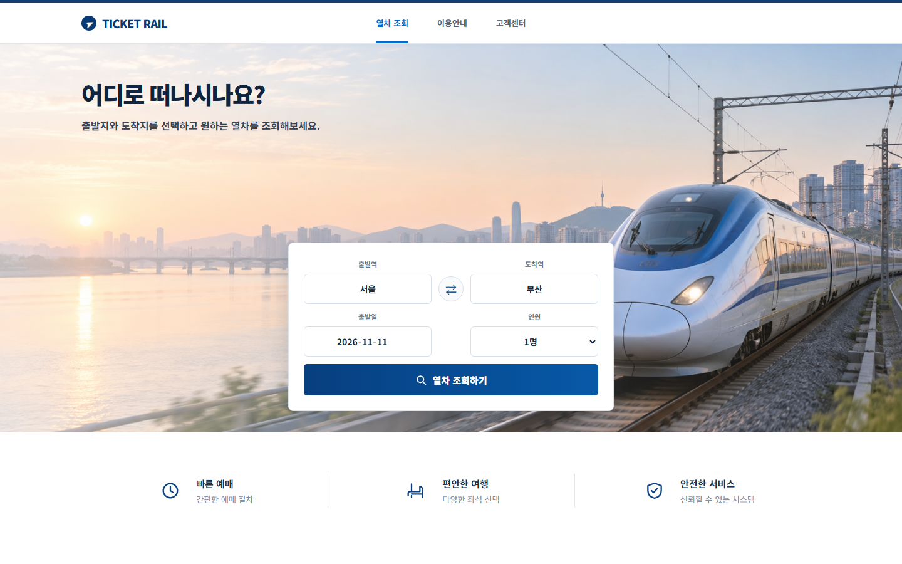
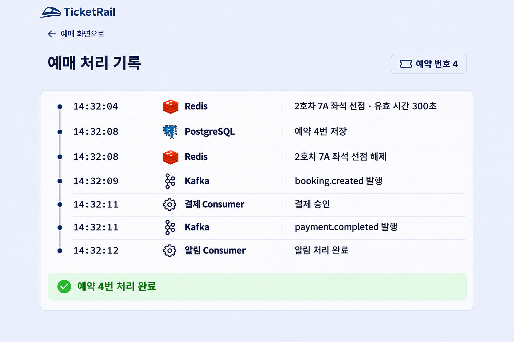

# TicketRail

온프레미스 Kubernetes에서 구축하고 클라우드로 확장한 열차 예매 서비스입니다.

[프로젝트 상세](https://app.notion.com/p/TicketRail-40f7416fb05f81e4bdfaeedf3dcbaebb?pvs=12)

## 프로젝트 구분

| 프로젝트 | 이름 |
| --- | --- |
| 1차 | [Kubernetes 기반 열차 예매 인프라 구축](docs/first-project.md) |
| 2차 | [열차 예매 인프라의 클라우드 확장 및 성능 검증](docs/second-project.md) |

## 직접 실행해 보기

### 1. 예매 체험



1. [미리보기 ZIP](https://github.com/wldnjs0653/ticket-rail/releases/download/html-preview-v1/TicketRail-preview.zip)을 다운로드한 뒤 압축을 풉니다.
2. 압축을 푼 폴더에서 **`preview.html`**을 더블클릭합니다.

### 2. 서비스 연동 확인



*Windows에서 실행하려면 [Docker Desktop](https://docs.docker.com/desktop/setup/install/windows-install/)이 필요합니다.*

1. **Docker Desktop**을 열고 Docker 엔진이 시작될 때까지 기다립니다.
2. **PowerShell**을 열고 아래 명령을 실행합니다.

   ```powershell
   git clone https://github.com/wldnjs0653/ticket-rail.git "$HOME\ticket-rail"
   docker compose -f "$HOME\ticket-rail\projects\phase-2\docker-compose.local.yml" up --build --wait --wait-timeout 240
   ```

3. [예매 화면](http://localhost:3000/ticketing.html)을 열고 열차와 좌석을 선택해 예매합니다.
4. 예매 결과 화면에서 **처리 기록 보기**를 누릅니다.
5. 체험을 마치면 아래 순서로 종료합니다.

   **5-1. 서비스 종료**

   PowerShell에서 아래 명령을 실행합니다.

   ```powershell
   docker compose -f "$HOME\ticket-rail\projects\phase-2\docker-compose.local.yml" down
   ```

   **5-2. Docker Desktop 종료**

   같은 PowerShell에서 아래 명령을 실행합니다.

   ```powershell
   docker desktop stop
   ```
