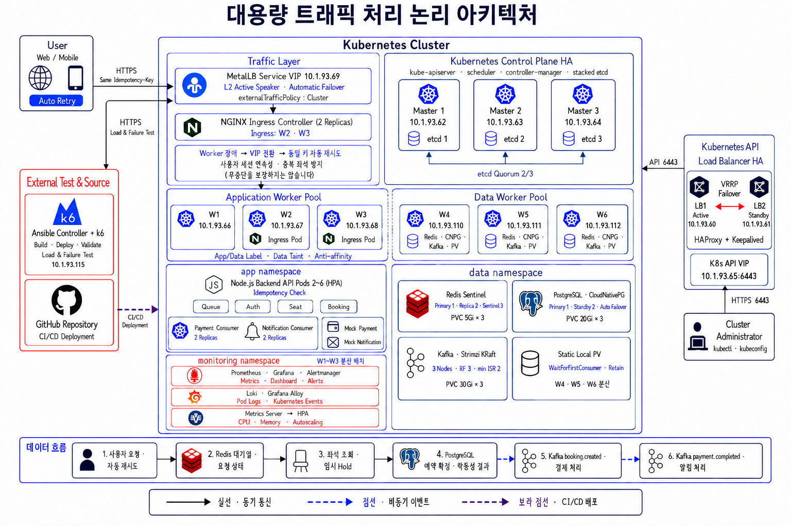
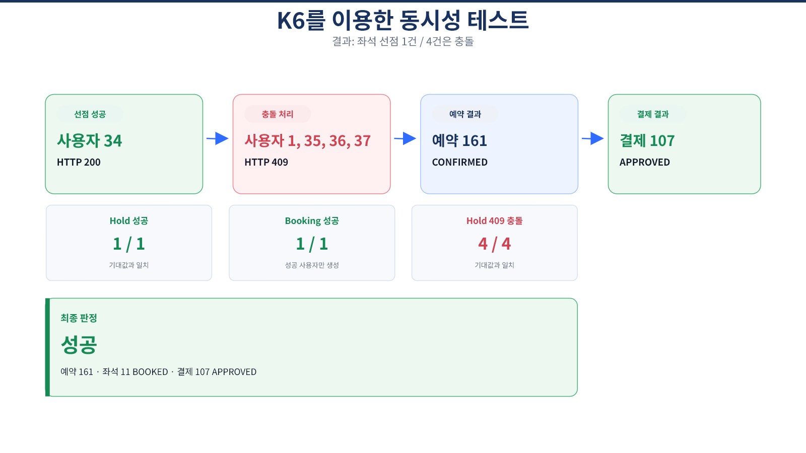
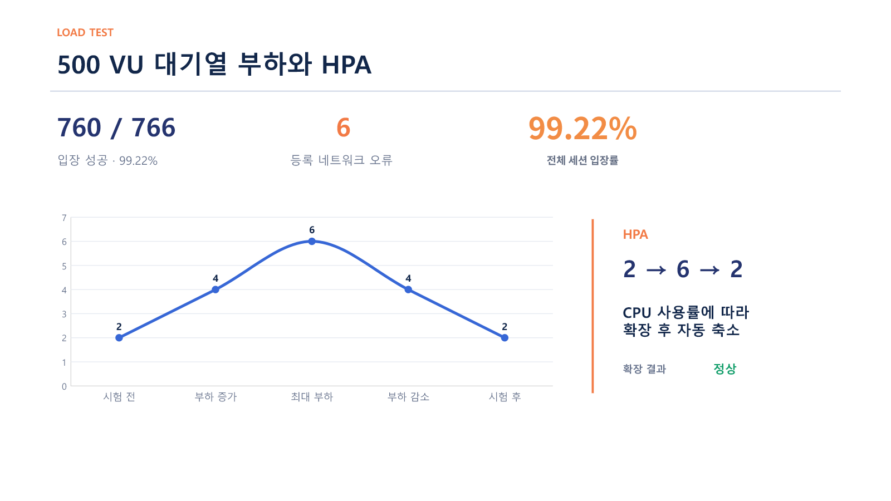

# TicketRail ① 대용량 티켓 예매 인프라 구축

대기열·좌석 선점·예약을 처리하는 **Kubernetes 기반 고가용성 인프라**를 구축하고 부하·장애 대응을 검증했습니다.

| 기간 | 팀·역할 | 환경 |
| --- | --- | --- |
| 2026.08.25 ~ 09.23 | 4명 · 팀장, 논리 설계·시험·통합 검증 | 온프레미스 Kubernetes |

[핵심 성과](#핵심-성과) · [담당 업무](#담당-업무) · [구성과 처리 흐름](#구성과-처리-흐름) · [검증 상세](#검증-상세) · [코드·실행](#코드와-실행)

## 핵심 성과

| 항목 | 검증 결과 |
| --- | --- |
| 대기열 | 최대 **500 VU**, **760 / 766개 세션 입장** |
| 자동 확장 | Backend Pod **2 → 6 → 2개** |
| 좌석 선점 | 동일 좌석 동시 요청 **5건 중 1건 성공** |
| 장애 대응 | Pod·Worker·Control Plane·LB·데이터 계층 **7개 시나리오** |

500 VU 시험은 대기열·좌석 조회를 대상으로 했으며, 결제·알림은 모의 서비스로 구현했습니다. 시험 조건과 세부 측정값은 아래에서 펼쳐 볼 수 있습니다.

## 담당 업무

- **팀 운영:** 범위·일정·역할 조율, 기술 이슈와 결과 공유
- **설계:** 전체 논리 아키텍처와 구성 요소 연결 방식 정의
- **검증:** 기능·동시성·부하·장애 시험 설계·수행·분석, 보고서·발표 자료 정리

Backend 개발, Kubernetes HA·CI/CD 세부 구현과 모니터링은 팀원이 담당했으며, 개인 기여는 설계와 시험·통합 검증을 중심으로 소개합니다.

## 구성과 처리 흐름

**사용자 → MetalLB·NGINX Ingress → Backend API → 대기열·좌석 선점·예약**

| 구성 | 역할 |
| --- | --- |
| Redis Sentinel | 대기열·입장·좌석 임시 선점 |
| PostgreSQL · CNPG | 예약·좌석·결제 데이터 저장 |
| Kafka · Consumer | 예약 이벤트 → 모의 결제 → 결제 완료 이벤트 → 모의 알림 |
| HPA · 배포 자동화 | Backend 자동 확장, GitHub Actions·Ansible 배포 |

<details>
<summary><strong>전체 아키텍처 보기</strong> — 노드·네트워크·데이터 계층</summary>

<p align="center">
  <a href="architecture.png">
    
  </a>
</p>

<p align="center"><sub>이미지를 클릭하면 원본 크기로 확인할 수 있습니다.</sub></p>

Control Plane 3대, 애플리케이션 Worker 3대, 데이터 Worker 3대로 구성했습니다. HAProxy·Keepalived는 Kubernetes 관리 API, MetalLB·NGINX Ingress는 사용자 서비스 진입을 담당합니다.

</details>

## 검증 상세

기능 → 동시성 → 부하 → 장애 순서로 기대 결과와 실제 측정값을 확인했습니다.

<details>
<summary><strong>좌석 동시성 시험</strong> — 5건 중 1건 성공, 4건 HTTP 409</summary>

동일 좌석에 5명이 최대 1ms 차이로 요청하도록 구성했습니다. 한 명만 선점과 예약에 성공했고, 나머지 네 명에게 HTTP 409를 반환했습니다.

| 측정 항목 | 결과 |
| --- | --- |
| 동시 사용자 | 5명 |
| 좌석 선점 성공 | 1건 |
| 충돌 처리 | 4건, HTTP 409 |
| 예상 외 응답 | 0건 |
| 네트워크 실패 | 0건 |



</details>

<details>
<summary><strong>대기열 부하 시험</strong> — 최대 500 VU, 760 / 766개 세션 입장</summary>

대기열 등록부터 입장 확인과 좌석 조회까지 시험했습니다. 전체 766개 세션 중 760개가 입장을 완료했으며, 등록 단계에서 네트워크 오류 6건을 확인했습니다.

| 측정 항목 | 결과 |
| --- | --- |
| 최대 동시 실행 수 | 500 VU |
| 입장 완료 | 760 / 766, 99.22% |
| 등록 네트워크 오류 | 6건 |
| 좌석 조회 | 430,169건, 실패 0건 |
| Backend Pod | 2개 → 6개 → 2개 |

예약과 결제 성능은 시험 범위에서 제외했습니다. `500 VU`는 최대 동시 실행 수이며, 한 VU가 여러 세션을 수행해 전체 766개 세션이 시작됐습니다.



</details>

<details>
<summary><strong>장애 시험</strong> — 7개 계층별 전환·복구 시나리오</summary>

| ID | 장애 대상 | 핵심 결과 |
| --- | --- | --- |
| P-01 | NGINX Pod | 대체 Pod Ready 3.968초, HTTPS 23 / 23 성공 |
| N-01 | Application Worker W2 | 관측 구간 147 / 147 성공, 남은 Worker로 트래픽 재분배 |
| C-01 | Control Plane M1 | Kubernetes API 127 / 127 성공, 서비스 재가동 후 Ready 1.396초 |
| L-01 | Active API LB1 | API VIP 전환 2.423초, Probe 30 / 30 성공 |
| D-01 | Redis Primary | Replica 승격 7.905초, Marker 데이터 보존 |
| D-02 | PostgreSQL Primary | Standby 승격 182.718초, Marker 데이터 보존 |
| D-03 | Kafka Broker | ISR와 대체 UID 확인 28.689초, Marker 메시지 보존 |

</details>

<details>
<summary><strong>발견한 문제와 개선 보기</strong></summary>

| 문제 | 적용한 개선 |
| --- | --- |
| 장시간 대기 중 토큰 만료 | TTL 600 → 3,900초 조정 후 재시험 |
| 대기열 지표 의미 불일치 | 현재 입장자와 누적값 분리 |
| 시험 결과 경로 불일치 | Run 시작 시 결과 경로 고정 |
| 배포 이미지 추적 | Git SHA 기반 불변 태그 적용 |

Worker 장애 시험은 노드 식별용 경량 Probe를 사용했으며 실제 예약 API 부하 시험과 구분했습니다. 전환·복구 시간은 각 시험의 측정 단계와 관측 구간을 기준으로 합니다.

</details>

## 사용 기술

| 목적 | 기술 |
| --- | --- |
| 시스템·플랫폼 | Linux · Kubernetes · Docker |
| 트래픽·고가용성 | NGINX Ingress · MetalLB · HAProxy · Keepalived |
| 데이터·이벤트 | Redis Sentinel · PostgreSQL(CNPG) · Kafka |
| 자동화·관측·시험 | Ansible · GitHub Actions · Prometheus · Grafana · Loki · k6 |

## 코드와 실행

[애플리케이션](../src) · [배포 구성](../k8s) · [자동화](../ansible) · [시험](../tests)

### 로컬 실행

저장소 루트에서 실행합니다. Kubernetes 배포·부하·장애 시험 자료는 위 코드 링크에서 확인할 수 있습니다.

```bash
cp .env.example .env
docker compose -f docker-compose.local.yml up -d
npm ci
npm test
npm start
```

`.env`는 로컬 개발용 예시를 기반으로 생성하며 Git에 포함되지 않습니다.

[전체 소개](../README.md) · [2차 프로젝트: 확장·성능 개선](second-project.md)
