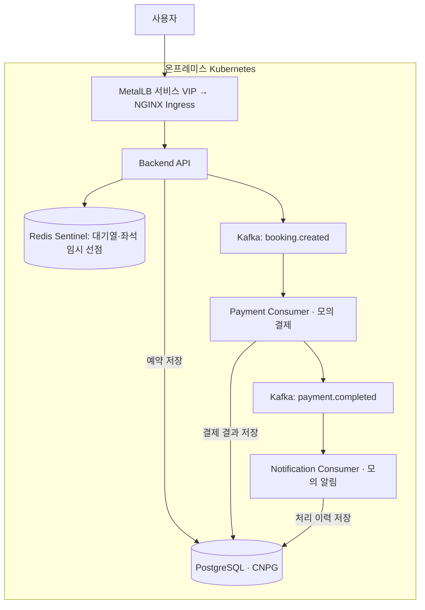
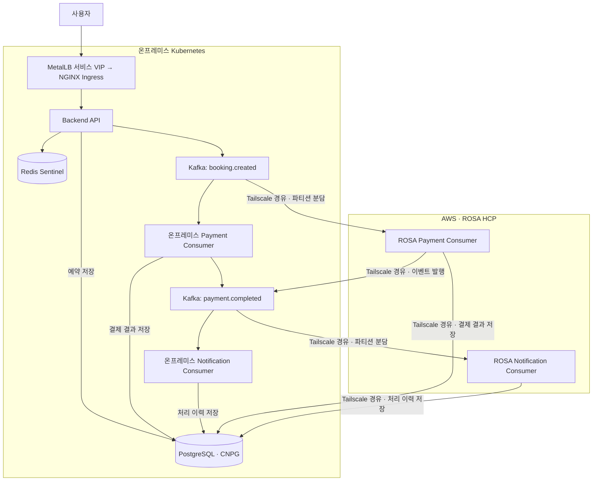
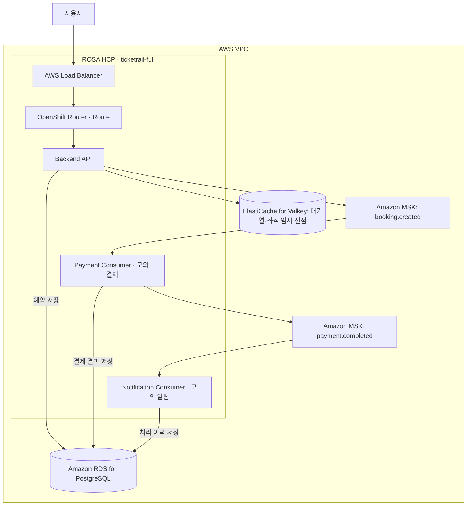

# TicketRail ② 하이브리드 클라우드 확장 및 성능 검증

1차 프로젝트의 온프레미스 Kubernetes 티켓 예매 서비스를 기반으로 Consumer 처리 병목을 분석하고, 하이브리드와 Full AWS 환경으로 확장해 예매부터 모의 결제·알림까지의 처리와 장애 복구를 검증했습니다.

- 기간: 2026.09.28 ~ 2026.10.26
- 인원: 2명
- 역할: 팀장, 아키텍처 통합 설계, 부하·장애 시험 및 개선

## 담당 업무

- 프로젝트 진행 방향과 역할을 조율하고 환경별 설계와 시스템을 통합했습니다.
- Kafka Consumer 처리 병목을 분석해 Consumer 증설, Pod 내부 동시성, 확장 정책을 조정했습니다.
- k6 부하 시험과 Kafka Lag, 업무 처리 건수를 분석해 온프레미스·하이브리드·Full AWS 환경을 검증했습니다.
- Redis Primary 변경 감지와 연결 정보 갱신, 안전한 재시도를 보완했습니다. PostgreSQL의 CloudNativePG 장애 전환 설정과 읽기 요청 재시도를 조정하고 복구를 확인했습니다.
- CI/CD, 사용자 화면, 모니터링을 보완하고 시험 결과와 보고서를 정리했습니다.

AWS 네트워크와 Terraform·ROSA 인프라 구축, 환경 간 연결 및 DR 구성은 팀원이 담당했으며, 구성과 시험 결과는 함께 검토했습니다.

## 구성과 처리 흐름

세 환경은 같은 예매 업무를 처리하며, API·데이터·Consumer의 배치와 연결 경로를 단계적으로 확장했습니다. 결제와 알림은 모의 서비스로 검증했습니다.

| 환경 | 사용자 요청·데이터 위치 | 결제·알림 처리 위치 |
| --- | --- | --- |
| 온프레미스 | Kubernetes API · Redis Sentinel · PostgreSQL(CNPG) · Kafka | 온프레미스 Kubernetes |
| 하이브리드 | 온프레미스 API·데이터 계층 유지 | 온프레미스와 AWS ROSA가 분담, Tailscale로 연결 |
| Full AWS | ROSA API · ElastiCache for Valkey · RDS for PostgreSQL · MSK | AWS ROSA |

### 1. 온프레미스: 기존 Kubernetes에서 전체 예매 흐름 처리

애플리케이션·모니터링 Worker와 데이터 Worker를 분리하고, Kubernetes 내부에서 API와 결제·알림 Consumer, 데이터 계층을 운영했습니다.

1. 사용자 요청이 MetalLB 서비스 VIP와 NGINX Ingress를 거쳐 Backend API에 도착합니다.
2. API가 Redis에서 대기열 등록·입장 승인·좌석 임시 선점을 처리하고 예약 정보를 PostgreSQL에 저장한 뒤, Kafka의 `booking.created` 이벤트를 발행합니다.
3. Payment Consumer가 모의 결제를 처리하고 결과를 저장한 뒤 `payment.completed` 이벤트를 발행합니다. Notification Consumer가 이 이벤트를 받아 모의 알림과 처리 이력 저장을 수행합니다.
4. 사용자는 API로 처리 상태를 조회합니다. API는 HPA로, Consumer는 Kafka Lag를 기준으로 KEDA로 확장합니다.

### 2. 하이브리드: 온프레미스 서비스를 유지하고 ROSA Consumer로 분산

사용자 진입점과 API·Redis·PostgreSQL·Kafka는 온프레미스에 유지하고, AWS ROSA HCP에 결제·알림 Consumer를 추가했습니다. 양쪽 Tailscale Subnet Router를 통해 ROSA Consumer가 온프레미스 Kafka와 PostgreSQL에 접근합니다.

1. 사용자 요청은 온프레미스 API로 들어오며, 대기열·좌석 선점·예약 저장과 `booking.created` 발행도 온프레미스에서 수행합니다.
2. 온프레미스와 ROSA의 Payment Consumer가 **동일한 결제 Consumer Group**에 참여해 Kafka 파티션을 나누어 처리합니다. ROSA Consumer의 Kafka 구독·발행과 PostgreSQL 접근은 Tailscale 경로를 사용합니다.
3. 결제 결과를 온프레미스 PostgreSQL에 저장하고 온프레미스 Kafka에 `payment.completed`를 발행합니다. 양쪽 Notification Consumer도 **동일한 알림 Consumer Group**에서 파티션을 나누어 모의 알림을 처리하고 이력을 저장합니다.
4. 각 클러스터의 KEDA가 해당 환경의 Consumer Pod 수를 조정하고, Kafka가 공통 Consumer Group 내 파티션을 재분배합니다. 그림의 두 갈래는 같은 이벤트의 중복 처리가 아니라 처리 작업의 분담을 나타냅니다.

### 3. Full AWS: API·Consumer·데이터 계층을 AWS에 구성

ROSA HCP에 Backend API와 결제·알림 Consumer를 배포하고, 데이터 계층을 AWS 관리형 서비스로 구성했습니다. ROSA Worker와 데이터 서비스는 VPC의 Private Subnet에 배치했습니다.

1. 사용자 요청이 AWS Load Balancer와 OpenShift Route를 통해 ROSA의 Backend API로 전달됩니다.
2. API가 ElastiCache for Valkey에서 대기열·입장·좌석 임시 상태를 관리하고, 예약 정보를 RDS for PostgreSQL에 저장한 뒤 MSK에 `booking.created`를 발행합니다.
3. ROSA Payment Consumer가 모의 결제를 처리하고 RDS에 결과를 저장한 뒤 MSK에 `payment.completed`를 발행합니다. Notification Consumer는 이 이벤트로 모의 알림을 처리하고 RDS에 이력을 저장합니다.
4. API는 HPA로, Consumer는 MSK Lag를 기준으로 KEDA로 확장합니다. 정상 예매 업무의 API·데이터·이벤트 처리는 AWS 내부에서 이어집니다.

## 주요 검증 결과

| 환경 | 시험 및 결과 |
| --- | --- |
| 온프레미스 | Consumer 증설과 Pod 내부 동시성 조정 후 초당 31건의 예매 흐름 처리 확인 |
| 하이브리드 | 초당 60건의 예매 흐름을 유입하고 예약·모의 결제·알림 처리 완료 확인 |
| Full AWS | 초당 80건의 예매 흐름을 유입하고 예약·모의 결제·알림 처리 완료 확인 |

Full AWS 시험에서 HTTP 실패, Dropped Iteration, Flow Failure는 각각 0건이었고 종료 시 양쪽 Consumer Group Lag는 0이었습니다.

## 처리 병목 분석과 개선

부하를 높이며 API 응답과 예약·결제·알림 완료 건수, Kafka Consumer Group Lag를 함께 확인했습니다. 결제 처리 속도가 요청 유입을 따라가지 못해 Lag가 누적되는 구간을 확인하고 Consumer의 처리 용량을 우선 개선했습니다.

1. **온프레미스:** Payment Consumer Pod를 3개에서 6개로 늘리고 Pod별 동시 처리 수를 1개에서 4개로 조정했습니다. 단계별 시험에서 초당 8건, 17건, 31건의 처리 결과를 확인했습니다.
2. **하이브리드:** ROSA에 결제·알림 Consumer를 추가하고 Kafka 파티션과 동시성, 데이터베이스 연결을 조정했습니다. k6 부하와 Lag를 관측하고 최종 업무 완료 건수를 확인했습니다.
3. **Full AWS:** 결제·알림의 병렬 처리와 KEDA 축소 안정화 정책을 조정했습니다. 초당 80건의 시험에서 업무 완료 건수와 잔여 Lag를 확인했습니다.

## 장애 대응 개선

- **Redis:** Sentinel의 Primary 변경 감지와 연결 갱신을 보완해 비교 시험에서 API 복구 시간을 32.961초에서 7.081초로 줄였습니다. 후속 시험에서는 안전한 재시도를 적용했습니다.
- **PostgreSQL:** CloudNativePG의 종료 대기 설정을 조정해 비교 시험에서 Primary 전환 시간을 183.42초에서 32.98초로 줄였습니다. 장애 전 데이터 마커 보존과 API 정상화도 확인했습니다.
- **재해 복구:** 팀은 온프레미스 애플리케이션 장애를 재현하고 CloudWatch와 Route 53을 이용한 AWS 전환과 복귀를 검증했습니다.

DR 검증은 온프레미스 애플리케이션 중단에 따른 AWS 전환과 온프레미스 복귀를 대상으로 수행했습니다.

## 사용 기술

| 목적 | 사용 기술 |
| --- | --- |
| 인프라·컨테이너 플랫폼 | Linux · VMware · Kubernetes · ROSA HCP(OpenShift) · AWS |
| 서비스 진입·환경 간 연결 | MetalLB · NGINX Ingress · OpenShift Route · AWS Load Balancer · Tailscale Subnet Router |
| 데이터·이벤트 처리 | Redis Sentinel · PostgreSQL(CloudNativePG) · Kafka · Amazon RDS for PostgreSQL · Amazon MSK · ElastiCache for Valkey |
| 자동 확장 | HPA · KEDA · ROSA Worker 자동 확장 |
| IaC·배포 자동화 | Terraform · Ansible · GitHub Actions |
| 모니터링·성능 검증 | Prometheus · Grafana · k6 |
| 재해 복구 전환 | CloudWatch · Route 53 |

## 구현 소스 안내

2차 프로젝트 소스를 이 포트폴리오 저장소의 [`projects/phase-2`](../projects/phase-2)에 분리해 추가했습니다.

| 자료 | 확인 위치 |
| --- | --- |
| 소스 개요·출처·실행 방법 | [2차 소스 README](../projects/phase-2/README.md) |
| Consumer 병렬 처리 | [src/consumers](../projects/phase-2/src/consumers) |
| Redis·PostgreSQL 연결과 장애 대응 | [src/clients](../projects/phase-2/src/clients) |
| ROSA 배포·하이브리드 KEDA | [k8s_playbooks/rosa](../projects/phase-2/k8s_playbooks/rosa) |
| 온프레미스 KEDA | [consumer-keda.yaml](../projects/phase-2/k8s_playbooks/app/consumer-keda.yaml) |
| PostgreSQL 장애 전환 설정 | [postgresql.yml](../projects/phase-2/Data_Monitoring_playbooks/postgresql.yml) |
| 원본 경로와 체크섬 | [SOURCE.json](../projects/phase-2/SOURCE.json) |

원본은 [공동 저장소](https://github.com/jisoo9123/ticketing-project)의 `fix/payment-delay-confirmation-ui` 브랜치이며, [커밋 `3a97332`](https://github.com/jisoo9123/ticketing-project/commit/3a97332d37dad13485b9bcc450d84d0a5988526c)을 기준으로 반영했습니다. 원본 저자와 팀 공동 기여를 유지하고 개인 담당 업무를 위에 구분했습니다.

Terraform 파일과 Full AWS 최종 성능 시험의 전체 설정·결과 원본은 이 소스 브랜치에 포함되어 있지 않습니다. 가져온 구현 자료와 보고서의 시험 성과를 구분해 소개합니다.

[TicketRail 전체 소개](../README.md) · [1차 프로젝트 상세](first-project.md)
