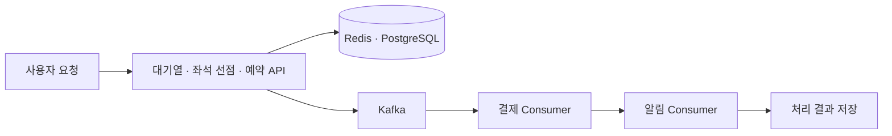

# TicketRail 2차 프로젝트

## Kubernetes 기반 티켓 예매 서비스의 하이브리드 클라우드 확장과 성능 검증

1차 프로젝트의 온프레미스 Kubernetes 티켓 예매 서비스를 기반으로 Consumer 처리 병목을 분석하고, 하이브리드와 Full AWS 환경으로 확장해 예매부터 모의 결제·알림까지의 처리와 장애 복구를 검증했습니다.

- 기간: 2026.09.28 ~ 2026.10.26
- 인원: 2명
- 역할: 팀장, 아키텍처 통합 설계, 부하·장애 시험 및 개선

## 담당 업무

- 프로젝트 진행 방향과 역할을 조율하고 환경별 설계와 시스템을 통합했습니다.
- Kafka Consumer 처리 병목을 분석해 Consumer 증설, Pod 내부 동시성, 확장 정책을 조정했습니다.
- k6 부하 시험과 Kafka Lag, 업무 처리 건수를 분석해 온프레미스·하이브리드·Full AWS 환경을 검증했습니다.
- Redis Primary 변경 감지와 연결 정보 갱신, 안전한 재시도를 보완했습니다. PostgreSQL의 CloudNativePG 장애 전환 설정과 읽기 요청 재시도를 조정하고 복구를 확인했습니다.
- CI/CD, 사용자 화면, 모니터링을 보완하고 시험 결과와 보고서를 정리했습니다.

AWS 네트워크와 Terraform·ROSA 인프라 구축, 환경 간 연결 및 DR 구성은 팀원이 담당했으며, 구성과 시험 결과는 함께 검토했습니다.

## 구성과 처리 흐름

| 환경 | 애플리케이션·데이터 | 결제·알림 처리 |
| --- | --- | --- |
| 온프레미스 | Kubernetes와 온프레미스 데이터 계층 | 온프레미스 Consumer |
| 하이브리드 | 온프레미스 애플리케이션·데이터 계층 | 온프레미스와 ROSA Consumer가 분담 |
| Full AWS | ROSA와 AWS 관리형 데이터·메시징 서비스 | ROSA Consumer |

- **온프레미스:** Kubernetes에서 애플리케이션, Redis, PostgreSQL, Kafka와 Consumer 운영
- **하이브리드:** 온프레미스 데이터 계층과 AWS ROSA에 추가된 결제·알림 Consumer를 사설 경로로 연결
- **Full AWS:** ROSA와 AWS 관리형 데이터·메시징 서비스를 이용해 전체 서비스 흐름 구성
- **자동화·관측:** Terraform, Ansible, GitHub Actions, HPA, KEDA, Prometheus, Grafana, k6

사용자 요청은 대기열과 좌석 선점, 예약을 거쳐 Kafka 기반 결제·알림 처리로 이어집니다. 결제와 알림은 모의 서비스로 검증했습니다.

## 주요 검증 결과

| 환경 | 시험 및 결과 |
| --- | --- |
| 온프레미스 | Consumer 증설과 Pod 내부 동시성 조정 후 초당 31건의 예매 흐름 처리 확인 |
| 하이브리드 | 초당 60건을 180초간 유입하고, 종료 후 관측에서 예약·모의 결제·알림 각 10,800건 처리 완료 확인 |
| Full AWS | 초당 80건, 600초 시험에서 예약·모의 결제·알림 각 48,000건 처리 확인 |

Full AWS 시험에서 HTTP 실패, Dropped Iteration, Flow Failure는 각각 0건이었고 종료 시 양쪽 Consumer Group Lag는 0이었습니다.

## 처리 병목 분석과 개선

부하를 높이며 API 응답과 예약·결제·알림 완료 건수, Kafka Consumer Group Lag를 함께 확인했습니다. 결제 처리 속도가 요청 유입을 따라가지 못해 Lag가 누적되는 구간을 확인하고 Consumer의 처리 용량을 우선 개선했습니다.

1. **온프레미스:** Payment Consumer Pod를 3개에서 6개로 늘리고 Pod별 동시 처리 수를 1개에서 4개로 조정했습니다. 단계별 시험에서 초당 8건, 17건, 31건의 처리 결과를 확인했습니다.
2. **하이브리드:** ROSA에 결제·알림 Consumer를 추가하고 Kafka 파티션과 동시성, 데이터베이스 연결을 조정했습니다. k6 부하와 Lag를 관측하고 최종 업무 완료 건수를 확인했습니다.
3. **Full AWS:** 결제·알림의 병렬 처리와 KEDA 축소 안정화 정책을 조정했습니다. 초당 80건의 600초 시험에서 업무 완료 건수와 잔여 Lag를 확인했습니다.

## 장애 대응 개선

- **Redis:** Sentinel의 Primary 변경 감지와 연결 갱신을 보완해 비교 시험에서 API 복구 시간을 32.961초에서 7.081초로 줄였습니다. 후속 시험에서는 안전한 재시도를 적용했습니다.
- **PostgreSQL:** CloudNativePG의 종료 대기 설정을 조정해 비교 시험에서 Primary 전환 시간을 183.42초에서 32.98초로 줄였습니다. 장애 전 데이터 마커 보존과 API 정상화도 확인했습니다.
- **재해 복구:** 팀은 온프레미스 애플리케이션 장애를 재현하고 CloudWatch와 Route 53을 이용한 AWS 전환과 복귀를 검증했습니다.

DR 검증은 온프레미스 애플리케이션 중단에 따른 AWS 전환과 온프레미스 복귀를 대상으로 수행했습니다.

## 사용 기술

Linux · Kubernetes · ROSA · AWS · Kafka · Redis · PostgreSQL · KEDA · Terraform · Ansible · GitHub Actions · Prometheus · Grafana · k6

## 저장소 안내

이 저장소의 기존 코드와 실행 안내는 1차 프로젝트를 중심으로 구성되어 있습니다. 이 문서는 2차 프로젝트의 설계, 담당 업무와 검증 결과를 소개합니다.
