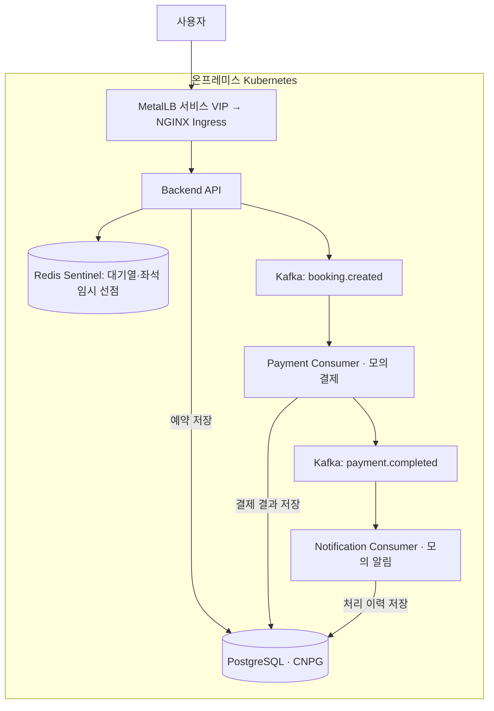
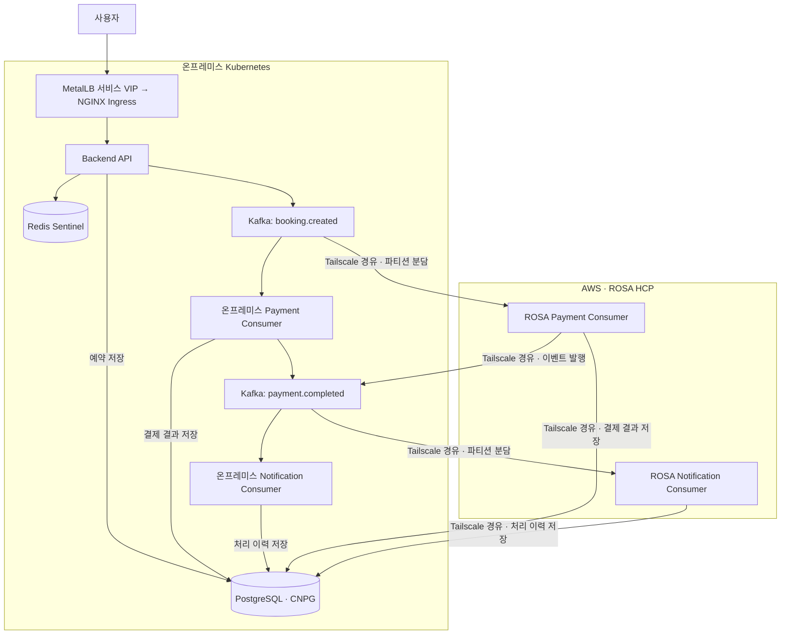
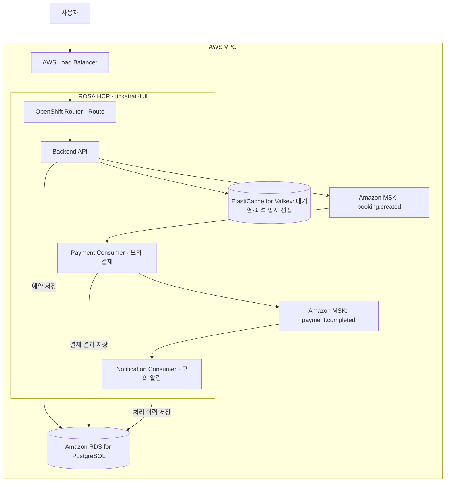

# TicketRail ② 하이브리드 클라우드 확장 및 성능 검증

기존 TicketRail의 **Consumer 병목·장애 복구를 개선**하고, 하이브리드와 Full AWS 환경으로 확장했습니다.

| 기간 | 팀·역할 | 확장 범위 |
| --- | --- | --- |
| 2026.09.28 ~ 10.26 | 2명 · 팀장, 통합 설계·성능·복구 검증 | 온프레미스 → 하이브리드 → Full AWS |

[핵심 성과](#핵심-성과) · [담당 업무](#담당-업무) · [환경별 구성](#구성과-처리-흐름) · [개선 과정](#주요-개선) · [코드·실행](#구현-소스-안내)

## 핵심 성과

| 항목 | 검증 결과 |
| --- | --- |
| 온프레미스 | Consumer 조정 후 **초당 31건**의 예매 흐름 처리 |
| 하이브리드 | **초당 60건** 유입 후 예약·모의 결제·알림 완료 |
| Full AWS | **초당 80건** 유입 후 예약·모의 결제·알림 완료 |
| Redis | API 복구 **약 33초 → 7초** |
| PostgreSQL | Primary 전환 **약 183초 → 33초** |

결제·알림은 모의 서비스로 검증했습니다. Redis는 API 복구, PostgreSQL은 Primary 전환 시간을 측정했습니다.

## 담당 업무

- **팀 운영·통합:** 역할 조율, 환경별 설계 검토·시스템 통합
- **성능 개선:** Consumer Pod·동시성·확장 정책 조정, k6·Kafka Lag·업무 완료 건수 검증
- **장애 복구:** Redis 연결 갱신·재시도와 PostgreSQL 장애 전환 설정 개선
- **운영 보완:** CI/CD·사용자 화면·모니터링 보완, 결과 문서화

AWS 네트워크·Terraform·ROSA 인프라와 DR 구성은 팀원이 담당했고, 구성·시험 결과는 함께 검토했습니다.

## 구성과 처리 흐름

**대기열 → 입장 승인 → 좌석 선점 → 예약 저장 → 모의 결제 → 모의 알림**

예약 후 Kafka `booking.created`로 결제를 요청하고, 결제 결과 저장 후 `payment.completed`로 알림 처리를 연결합니다.

| 환경 | API·데이터 배치 | 결제·알림 처리 |
| --- | --- | --- |
| **온프레미스** | Backend API · Redis · PostgreSQL · Kafka | 온프레미스 Consumer |
| **하이브리드** | 온프레미스 API·데이터 유지 | 온프레미스 + ROSA Consumer 분담, Tailscale 연결 |
| **Full AWS** | ROSA API · Valkey · RDS · MSK | ROSA Consumer |

환경별 도표와 처리 순서는 아래에서 펼쳐 볼 수 있습니다.

<strong>① 온프레미스 구성·처리 흐름 — Kubernetes에서 전체 예매 처리</strong>

1. MetalLB·NGINX Ingress → API → Redis 대기열·좌석 선점 → PostgreSQL 예약 저장
2. Kafka `booking.created` → Payment Consumer → 결제 저장 → `payment.completed` → Notification Consumer → 이력 저장

애플리케이션·모니터링 Worker와 데이터 Worker를 분리했습니다. API는 HPA, Consumer는 Kafka Lag 기반 KEDA로 확장합니다.

<strong>② 하이브리드 구성·처리 흐름 — 기존 서비스에 ROSA Consumer 추가</strong>

1. 요청 진입, Redis 선점, PostgreSQL 저장과 Kafka 이벤트 발행은 온프레미스에서 수행합니다.
2. 양쪽 Payment Consumer가 같은 결제 Consumer Group에서 파티션을 분담하고, 결제 후 `payment.completed`를 발행합니다. Notification Consumer도 같은 알림 Consumer Group에서 분담 처리합니다.
3. ROSA의 Kafka·PostgreSQL 접근은 양쪽 Tailscale Subnet Router를 경유합니다. 각 클러스터의 KEDA가 Consumer Pod를 조정하며 Kafka가 파티션을 재분배합니다.

그림의 두 갈래는 처리 작업의 분담을 나타냅니다.

<strong>③ Full AWS 구성·처리 흐름 — API·데이터·Consumer를 AWS에 배치</strong>

1. AWS Load Balancer·OpenShift Route → ROSA API → Valkey 대기열·좌석 선점 → RDS 예약 저장
2. MSK `booking.created` → Payment Consumer → RDS 결제 저장 → MSK `payment.completed` → Notification Consumer → RDS 이력 저장

ROSA Worker와 데이터 서비스는 VPC의 Private Subnet에 배치했습니다. API는 HPA, Consumer는 MSK Lag 기반 KEDA로 확장합니다.

## 주요 개선

| 문제·관측 | 조치 | 확인 결과 |
| --- | --- | --- |
| 결제 지연·Kafka Lag 누적 | Payment Pod **3 → 6개**, Pod별 동시 처리 **1 → 4개** | 온프레미스 단계별 **8 → 17 → 31건/초** |
| 추가 처리 용량 필요 | ROSA Consumer 추가, 파티션·동시성·DB 연결 조정 | 하이브리드 **60건/초** 흐름 검증 |
| Full AWS 병렬 처리·확장 조정 | 결제·알림 병렬 처리, KEDA 축소 안정화 정책 조정 | **80건/초**, 종료 시 양쪽 Consumer Lag **0** |

<strong>장애 복구·성능 검증 상세 보기</strong>

- **Redis:** Primary 변경 감지·연결 갱신 보완 후 API 복구 **32.961 → 7.081초**. 후속 시험에서 안전한 재시도를 적용했습니다.
- **PostgreSQL:** CNPG 종료 대기 설정 조정 후 Primary 전환 **183.42 → 32.98초**. 데이터 마커 보존과 API 정상화를 확인했습니다.
- **Full AWS:** HTTP 실패·Dropped Iteration·Flow Failure **각 0건**, 종료 시 결제·알림 Consumer Group Lag **각 0**.
- **DR:** 온프레미스 애플리케이션 장애 시 CloudWatch·Route 53을 통한 AWS 전환과 온프레미스 복귀를 팀에서 검증했습니다.

## 사용 기술

<strong>목적별 기술 목록 보기</strong> — 플랫폼·네트워크·데이터·자동화·관측

| 목적 | 사용 기술 |
| --- | --- |
| 인프라·컨테이너 플랫폼 | Linux · VMware · Kubernetes · ROSA HCP(OpenShift) · AWS |
| 서비스 진입·환경 간 연결 | MetalLB · NGINX Ingress · OpenShift Route · AWS Load Balancer · Tailscale Subnet Router |
| 데이터·이벤트 처리 | Redis Sentinel · PostgreSQL(CloudNativePG) · Kafka · Amazon RDS for PostgreSQL · Amazon MSK · ElastiCache for Valkey |
| 자동 확장 | HPA · KEDA · ROSA Worker 자동 확장 |
| IaC·배포 자동화 | Terraform · Ansible · GitHub Actions |
| 모니터링·성능 검증 | Prometheus · Grafana · k6 |
| 재해 복구 전환 | CloudWatch · Route 53 |

## 구현 소스 안내

[2차 코드·실행 안내](../projects/phase-2/README.md) · [Consumer](../projects/phase-2/src/consumers) · [장애 대응 코드](../projects/phase-2/src/clients) · [로컬 실행 검증](https://github.com/wldnjs0653/ticket-rail/actions/runs/40608744575)

<strong>구현 파일·출처 보기</strong> — 배포 구성과 원본 범위

2차 프로젝트 소스를 이 포트폴리오 저장소의 [`projects/phase-2`](../projects/phase-2)에 분리해 추가했습니다.

| 자료 | 확인 위치 |
| --- | --- |
| 소스 개요·출처·실행 방법 | [2차 소스 README](../projects/phase-2/README.md) |
| 로컬 예매·결제·알림 체험 | [Docker Compose 실행 안내](../projects/phase-2/README.md#로컬에서-예매-흐름-실행) |
| Consumer 병렬 처리 | [src/consumers](../projects/phase-2/src/consumers) |
| Redis·PostgreSQL 연결과 장애 대응 | [src/clients](../projects/phase-2/src/clients) |
| ROSA 배포·하이브리드 KEDA | [k8s_playbooks/rosa](../projects/phase-2/k8s_playbooks/rosa) |
| 온프레미스 KEDA | [consumer-keda.yaml](../projects/phase-2/k8s_playbooks/app/consumer-keda.yaml) |
| PostgreSQL 장애 전환 설정 | [postgresql.yml](../projects/phase-2/Data_Monitoring_playbooks/postgresql.yml) |
| 원본 경로와 체크섬 | [SOURCE.json](../projects/phase-2/SOURCE.json) |

원본은 [공동 저장소](https://github.com/jisoo9123/ticketing-project)의 `fix/payment-delay-confirmation-ui` 브랜치이며, [커밋 `3a97332`](https://github.com/jisoo9123/ticketing-project/commit/3a97332d37dad13485b9bcc450d84d0a5988526c)을 기준으로 반영했습니다. 원본 저자와 팀 공동 기여를 유지하고 개인 담당 업무를 위에 구분했습니다.

Terraform 파일과 Full AWS 최종 성능 시험의 전체 설정·결과 원본은 이 소스 브랜치에 포함되어 있지 않습니다. 가져온 구현 자료와 보고서의 시험 성과를 구분해 소개합니다.

[전체 소개](../README.md) · [1차 프로젝트: 인프라 구축](first-project.md)
